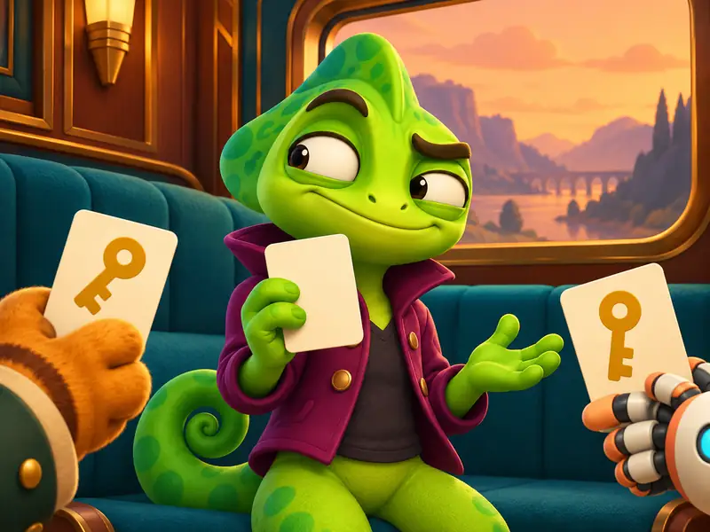
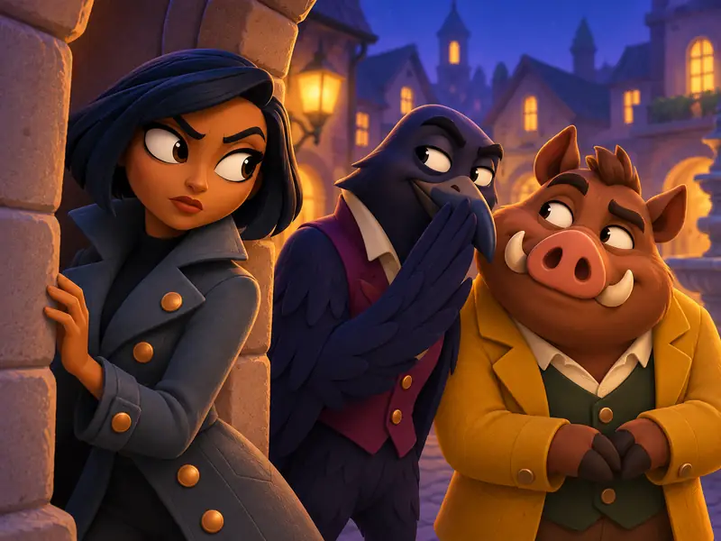
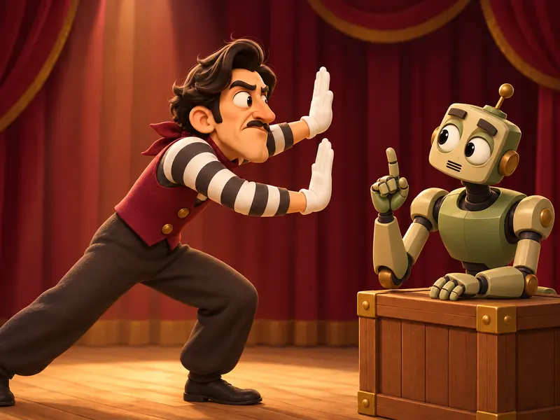

# Drei Bildproben für Secret Circle

Stand: 29. Oktober 2026. Auf Armans Wunsch auf GitHub gesicherte Vorschauen; keine endgültige Bildfreigabe und noch nicht als Spielbilder eingebaut.

Die neue Word-Imposter-Probe dient als gemeinsame Stilvorlage für Mafia und Scharade. Die Serie verwendet plastische 3D-Cartoonformen, markante Mimik und zur Rolle passende Kleidung. Figuren, Orte und Farben unterscheiden sich je Spiel.

## Word Imposter

Ein Chamäleon kennt den gemeinsamen Begriff nicht und versucht zu bluffen. [Vollständiger Prompt](imposter.prompt.txt).

## Mafia

Geheime Rollen, Misstrauen und eine entdeckte Absprache. [Vollständiger Prompt](mafia.prompt.txt).

## Scharade

Die überarbeitete Seitenansicht verdeutlicht die unsichtbare Wand. Der Roboter besitzt ein mechanisches Gesicht ohne menschliche Nase oder Lippen; eine Hand liegt auf der Kiste. [Generierungs- und Korrekturprompts](charades.prompt.txt).

## Vergleich und Herkunft

Die lokale Vergleichsseite unter `.cache/bildproben/2026-10-28-neue-serie/vergleich.html` zeigt die Motive groß und als kleine Kacheln mit 136 × 104 Pixeln. Die Bilder oben sind unmittelbar auf GitHub vergleichbar; lokale Arbeitsdateien und verworfene Varianten gehören nicht zu dieser dokumentierten Auswahl.

Erstellt mit dem integrierten OpenAI-Werkzeug `image_gen`; das konkrete Modell wurde vom Werkzeug nicht ausgewiesen. Export als WebP mit Pillow: 800 × 600 Pixel, je höchstens 35 KB. Prompts, Herkunft und SHA-256-Prüfsummen sind zusätzlich im [Provenienzmanifest](../../../assets/manifests/asset-provenance.json) dokumentiert.

Diese Dateien sind Dokumentation. Sie werden nicht beim Installieren der PWA geladen und verändern weder Spielabläufe noch gespeicherte Daten. Die Original-PNGs und frühere verworfene Proben bleiben lokal erhalten.
